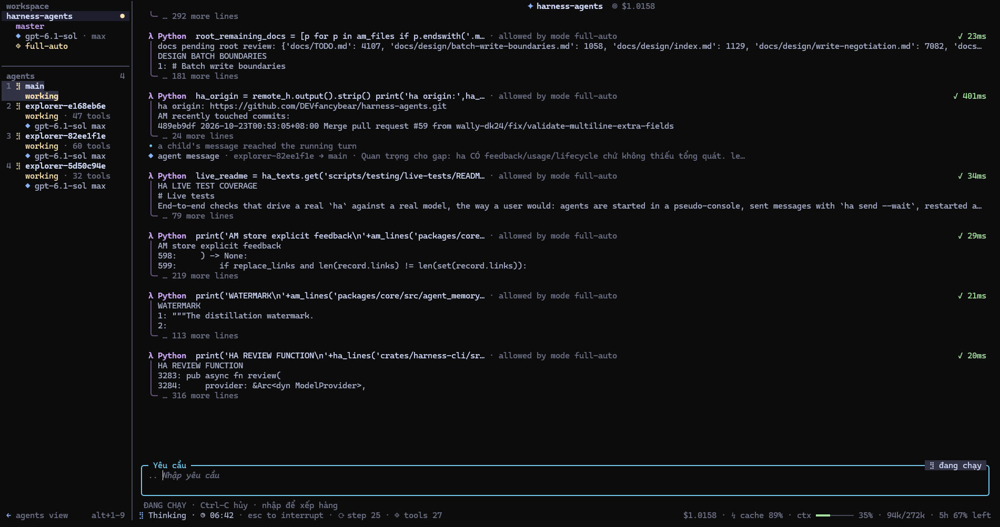
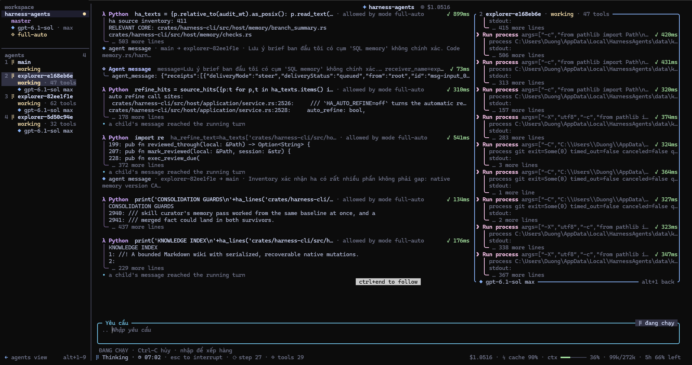
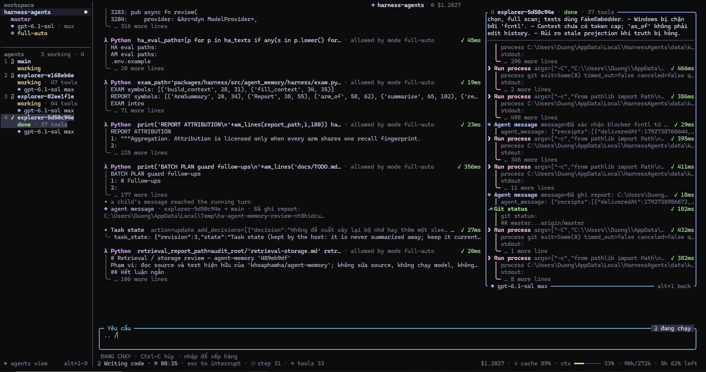

# Harness Agents

[](https://www.npmjs.com/package/harness-agents)
[](https://github.com/DEVfancybear/harness-agents/releases)


**A terminal coding agent whose harness, not the model, decides when the work is done.**
**Coding agent chạy trong terminal, nơi harness chứ không phải model quyết định khi nào việc đã xong, và không quên việc đã làm dù task kéo dài.**

`ha` reads, edits and runs your code through approval-gated tools, keeps every conversation in a local SQLite store, checks its own work with your project's checks and an independent verifier, and learns reusable skills from the sessions you have with it. On long tasks it does not forget what it did earlier: every tool call, result and steer stays in the conversation, and compaction extends one summary instead of rewriting it. It works with DeepSeek, OpenAI, Anthropic, ChatGPT Plus/Pro and OpenCode, and keeps their prompt caches hitting from one step to the next.

**Language / Ngôn ngữ:** [English](#english) · [Tiếng Việt](#tiếng-việt)

```powershell
npm install -g harness-agents
ha                      # then /login and start typing
```

### Screenshots / Ảnh chụp



*The main agent reads two repositories through the persistent Python REPL while three `explorer` children work in parallel; the sidebar lists each agent with its state, tool count and model, and a child's findings reach the running turn as a message. / Agent chính đọc hai repository qua Python REPL bền trong khi ba agent con `explorer` làm song song; sidebar liệt kê từng agent với trạng thái, số tool và model, và phát hiện của một agent con tới lượt đang chạy dưới dạng tin nhắn.*



*Alt+1..9 opens a child's pane beside the conversation: every call it makes, with its output, as it runs. / Alt+1..9 mở pane của một agent con cạnh cuộc hội thoại: từng lời gọi của nó, kèm output, ngay lúc chạy.*



*A finished explorer: its pane keeps its summary and the report it sent to the main agent, which records the decision in its task state. / Một explorer đã xong: pane giữ phần tóm tắt và báo cáo nó gửi cho agent chính, rồi agent chính ghi quyết định vào task state.*

---

## English

### Highlights

| | |
| --- | --- |
| **Guarded tools** | Read, search, patch and write files, run shell commands and processes, inspect Git, fetch and search the web. Every action passes the host policy: `ask`, `auto-edit` or `full-auto`, with deny rules that always hold. |
| **Persistent Python REPL** | prime-agent's kernel: variables survive across turns, `bash()` runs commands in the background, `rlm.spawn()` fans out explorer agents in parallel. |
| **Verified work** | `[verify]` checks the harness runs itself, an independent `verifier` agent that cannot edit and reports its findings back to the running turn, goals that only complete when both pass, and a feature list only a real verification can mark passing. |
| **Long-running work** | `/goal` keeps working across turns, `ha exec --autonomous` loops until your gates pass, and background agents keep running after the terminal closes. A recovered agent comes back with the approval mode, profile and effort it was launched with. |
| **Memory that holds** | Earlier turns are replayed with their tool calls, results, steers and host messages, not just the question and answer. Compaction keeps one rolling summary that each pass extends, splits a turn too large to keep and summarises its start, anchors the latest state, and keeps the cumulative list of files read and modified. `/resume` brings all of it back. The model keeps what should outlast the conversation with the `memory` tool (your preferences and decisions globally, a project's facts for that project only, task state per conversation), with or without the Python REPL, and `history_search` with `scope: "project"` finds what was said in earlier conversations of the project. Pinned entries are shown in every turn, every entry says how old it is and where it was written, and a search takes up to four wordings at once, so a question in Vietnamese finds an entry written in English. An update or delete keeps the earlier version (`history`, `restore`), and a new entry that repeats a kept one is refused with the entry to update. A project knowledge library keeps researched notes, out of Git. |
| **Session continuity** | App conversations keep their turns in the journal automatically. A new conversation receives bounded historical excerpts of the previous conversation in the same workspace, even without `/handoff`; `/refinements off` suppresses them. Recent commits, uncommitted files and the last `/handoff` remain in the startup brief; `/resume`, `/tree` and forks move around the full conversation history. |
| **Learned skills** | `/learn` turns what a conversation taught (a corrected approach, a fix, a setup step, your preferences) into `SKILL.md` skills; `/refine` tunes the harness more broadly: memory, skills, checks, prompt addendums, with `--global`, `--curate` and `--rollback`. A background review does the same at checkpoints, after a goal completes or coders' work is merged, and writes memory every conversation sees and new knowledge pages, as CowAgent's Self-Evolution does; a memory curator keeps the global memory to about 30 entries and out of task state, and `/refine --history` shows what every refinement changed and why. Skills pass a lint, are counted when used together with whether your checks passed afterwards and how the review judged the turn went (a failure keeps what the skill took for granted, so the curator can add a check for it), and are handed to child agents too. A skill nobody uses is archived; moving it back gives it a new trial. |
| **Prompt caching** | A follow-up request begins with the previous request word for word: tools are sorted, blocks already sent are not sent again, and history is replayed as it was sent. Each provider gets its cache key, breakpoints and retention, and the status line shows `↯ cache NN%`. |
| **Open ecosystem** | Agent Skills, MCP servers with OAuth sign-in and a service catalog (`/plugins`), prompt templates, hooks, `ha package` (npm, git, local), and `--mode rpc` / `--mode acp` for editors. |

### Install

**From npm** (Windows x64 release build):

```powershell
npm install -g harness-agents
ha --version
```

npm puts `ha` in its global directory (`npm prefix -g`), which Node's installer keeps on your PATH.

**From source** (needs [Rust](https://rustup.rs), Git and PowerShell 7):

```powershell
git clone https://github.com/DEVfancybear/harness-agents.git
cd harness-agents
pwsh -NoProfile -File scripts/install/Install-Ha.ps1        # release build into %USERPROFILE%\.cargo\bin
```

To update a source install, pull and run `Install-Ha.ps1` again; `cargo build` alone does not replace the `ha` on your PATH (`Get-Command ha -All` shows which one runs). No key yet? `ha chat --fixture` opens the interface against a scripted provider.

### First run

```text
ha                         open the app
/login                     DeepSeek, OpenAI, Anthropic, OpenCode (API key) or ChatGPT Plus/Pro (browser)
/model                     pick a model your logins can use
/effort                    pick how much it reasons
```

`ha "fix the failing test"` opens the app with a first prompt; `ha exec "…" --output-format json` runs one prompt for scripts and CI.

### Everyday commands

| You want to | Type |
| --- | --- |
| See every command | `/` (fuzzy menu), `/help`, `/hotkeys` |
| Continue or branch a conversation | `/resume`, `/tree`, `/fork`, `/new` |
| Attach files or images | `@`, `/attach <path>`, Ctrl-V for screenshots |
| Run a shell command | `!command` (goes through approval) |
| Redirect a running turn | `/steer <text>`, or just type while it runs |
| Work until something is done | `/goal <objective>`, `/goal status\|pause\|resume\|clear` |
| Check the work | `/verify`, `/review`, `/features` |
| Score the last turn on five quality axes (ECC's agent-self-evaluation) | `/self-eval [focus]`; a turn that changed 3+ files or 50+ lines is judged at its end on its own; `"selfEvaluation": "auto"\|"manual"\|"off"` or `HA_SELF_EVAL`; `ha learning report` shows the last 30 days |
| Hand over to the next session | `/handoff`, `/handoff --reset` |
| Keep a lesson as a skill | `/learn [focus]`, then `/skills` |
| Tune memory, skills and checks | `/refine [instructions]`, `/refine --global`, `/refine --curate`, `/refine --history [N]`, `/refine --rollback <id>`; `/refinements off` turns the whole harness off (saved state is kept) |
| prime-agent's factories (state machines of child agents) | `/factory on`, `/factory off`, `/factory status` |
| Search or manage saved research | `/knowledge`, `/knowledge search <query>`, `/knowledge read <path>`; `ha knowledge serve` opens the local console |
| Keep a project's memory as markdown files in Git (markdown-agent-memory) | `ha memory init [--hook] [--examples]`, `ha memory migrate` for a flat `MEMORY.md`, then `ha memory lint [--staged\|--no-diff]`; the rules and `MEMORY.md` reach every turn |
| See what the agent learned from corrections, and undo a rule | `ha learning list`, `ha learning show <id>`, `ha learning report [--html FILE]`, `ha learning retire <id>`; a correction seen in two conversations becomes a rule by itself, a project's wrong assumption a fact, and a daily meditation merges and rewords them |
| Move what the agent learned to another machine, or to every project (ECC's continuous-learning-v2) | `ha learning status` (lessons by domain, with confidence), `ha learning export [-o FILE]`, `ha learning import <FILE> [--dry-run]`, `ha learning promote <id>`; the daily meditation also makes one lesson of the same lesson in two projects, and gathers a workflow's rules into a learned skill |
| Let a guarded command through (deletes, kills by name, secret files, whole-drive searches) | Start ha with `HA_ALLOW_RECURSIVE_DELETE=1`, `HA_ALLOW_KILL_BY_NAME=1`, `HA_ALLOW_SECRET_PATHS=1`, `HA_ALLOW_ROOT_SEARCH=1`, `HA_ALLOW_HARNESS_WRITES=1` or `HA_ALLOW_SECRET_WRITES=1` |
| Shrink a long conversation | `/compact [what to keep]` |
| Connect services | `/plugins`, `/mcp add`, `/mcp login <service>`, `@server:uri` to attach a resource |
| Trust this project's config, hooks and MCP | `/trust`, then `/trust yes` |
| See cost, context, permissions | `/cost`, `/context`, `/permissions` |
| Audit the repository for agents | `/doctor` or `ha doctor` |

Keys: Enter sends, Ctrl-J or `\` then Enter add a line (Windows Terminal keeps Alt+Enter for full screen; Shift+Enter works where the console reports it), Esc interrupts, Ctrl-C cancels (twice on an empty prompt exits), Ctrl-O cycles collapsed / details / expanded, Ctrl-S stashes the draft, Alt+M cycles models. See [docs/guides/TUI.md](docs/guides/TUI.md).

### Background agents and automation

```powershell
ha agents                          # the agents still running for this project
ha attach <name>                   # reattach this terminal
ha send <name> "next step" --wait  # wake a saved conversation
ha send <name> "/goal" --wait      # slash commands run as commands and print what they show
ha stop <name>                     # stop it; the conversation stays
ha chat --model openai-codex/gpt-5.6-terra --approval full-auto
ha exec --autonomous --autonomous-gate "cargo test" "make the suite pass"
ha --mode rpc                      # JSON commands on stdin, events on stdout
ha --mode acp                      # Agent Client Protocol over stdio
```

A per-project worker keeps sessions alive after the terminal closes and recovers them from its journal with the settings they were launched with (`HA_DAEMON=off` disables it). `--model provider/id` picks a catalog model together with its provider. In Git Bash, MSYS turns an argument starting with `/` into a Windows path (`/goal` becomes `C:/Program Files/Git/goal`); `ha send` reads such a command back and says so, and `MSYS_NO_PATHCONV=1` keeps it as typed.

### Configuration

Settings merge default → user `config.toml` → trusted project `.harness/config.toml` → environment → command line; `/config` shows where each value came from. Project checks live under `[verify]`:

```toml
[[verify.checks]]
name = "tests"
command = "cargo test --workspace"
hint = "Fix the failing test before finishing."
```

| Variable | Default | Meaning |
| --- | --- | --- |
| `DEEPSEEK_API_KEY`, `OPENAI_API_KEY`, `ANTHROPIC_API_KEY`, `OPENCODE_API_KEY` | — | Provider keys; a key saved with `/login` wins |
| `HA_PROVIDER_ENDPOINT` / `HA_PROVIDER_MODEL` | DeepSeek / `deepseek-v4-flash` | Any OpenAI-compatible chat endpoint and model |
| `HA_CACHE_RETENTION` | short | `long`: Anthropic's 1-hour cache, OpenAI's 24-hour retention |
| `HA_TURN_MAX_STEPS` / `HA_TURN_MAX_TOOL_CALLS` | no limit | Model and tool calls per turn before it pauses |
| `HA_TURN_DEADLINE_SECONDS` | 900 | Time per turn |
| `HA_COMPACT_AT` | 200000 | Tokens of context before it is compacted, however large the model's window (`0`: the window's own bound) |
| `HA_SKILL_PATHS` | — | Extra skill directories (e.g. `~/.claude/skills`) |
| `HA_AUTO_REFINE` / `HA_SKILL_LIFECYCLE` | on | `off` stops the background review / keeps unused learned skills |
| `SERPER_API_KEY` | — | Google results for `web_search`; the DeepSeek key also searches (DeepSeek Search), and DuckDuckGo needs no key |
| `HA_WEB_SEARCH` | `deepseek,serper` | Order of the search APIs `web_search` asks (`[web] search`); a failing one hands over to the next |
| `HA_WEB` / `HA_REPL` / `HA_DAEMON` | on | `off` removes web tools / the Python REPL / background agents |
| `HA_PYTHON` | `python3`, `python`, `py -3` | Interpreter for the REPL kernel (3.11+) |
| `HA_UI` | auto | `plain` forces line mode |

### Platform

| Platform | Status |
| --- | --- |
| Windows 10/11 x64 | Supported; every CI gate runs here |
| Linux | Pending: it builds and CI runs it, but it is not supported yet |
| macOS | Not tested |

### Development

```powershell
cargo build -p harness-cli --bin ha --locked
cargo test --workspace --locked
cargo clippy --workspace --all-targets --locked -- -D warnings
pwsh -NoProfile -File scripts/verify/Verify-Docs.ps1
pwsh -NoProfile -File scripts/testing/Invoke-HaPtyAcceptance.ps1   # the terminal-driven suite
```

CI runs the phase and milestone gates on Windows; a test that fails in the crowded full run is re-run alone before the gate fails.

### Documentation

- [Operator guide](docs/guides/OPERATOR_GUIDE.en.md): every command, setting and workflow
- [Documentation index](docs/README.md)
- [Architecture overview](docs/architecture/ARCHITECTURE_OVERVIEW.en.md) · [Terminal interface](docs/guides/TUI.md) · [Plugin architecture](docs/architecture/PLUGIN_ARCHITECTURE.en.md)
- [Desktop computer use](docs/guides/COMPUTER_USE.md) (in development): real screenshots, mouse and keyboard on Windows
- [The Jev workflow](docs/guides/JEV.en.md) (plugin, off by default): TypeSafe's Jev for fast typed decisions beside the agent and at the harness's decision points
- [Build and release](docs/guides/BUILD_AND_RELEASE.md) · [Changelog](https://github.com/DEVfancybear/harness-agents/releases)

---

## Tiếng Việt

### Điểm nổi bật

| | |
| --- | --- |
| **Công cụ có kiểm soát** | Đọc, tìm, sửa và ghi file, chạy lệnh shell và tiến trình, xem Git, tìm và đọc web. Mọi thao tác đi qua chính sách của host: `ask`, `auto-edit` hoặc `full-auto`, rule deny luôn được giữ. |
| **Python REPL bền** | Kernel của prime-agent: biến được giữ qua các lượt, `bash()` chạy lệnh nền, `rlm.spawn()` chạy song song các agent khám phá. |
| **Kiểm chứng thật** | Các check `[verify]` do harness tự chạy, agent `verifier` độc lập không được sửa file và báo phát hiện của nó về lượt đang chạy, goal chỉ hoàn thành khi cả hai qua, và feature list chỉ được đánh dấu passing bằng một lượt kiểm chứng thật. |
| **Việc dài hơi** | `/goal` làm tiếp qua nhiều lượt, `ha exec --autonomous` lặp tới khi các gate qua, agent nền vẫn chạy sau khi đóng terminal. Agent được khôi phục giữ nguyên chế độ duyệt, profile và mức suy luận lúc khởi chạy. |
| **Trí nhớ bền** | Các lượt trước được phát lại cùng tool call, kết quả, steer và tin nhắn của host, không chỉ câu hỏi và câu trả lời. Compaction giữ một bản tóm tắt cuốn chiếu được nối thêm mỗi lần, tách lượt quá lớn và tóm tắt phần đầu của nó, neo trạng thái mới nhất, và giữ danh sách cộng dồn các file đã đọc và đã sửa. `/resume` nạp lại tất cả. Model giữ điều cần nhớ lâu bằng tool `memory` (sở thích và quyết định của bạn ở global, dữ kiện của một project chỉ cho project đó, trạng thái việc theo từng hội thoại), có hay không có Python REPL; mục ghim hiện ở mọi lượt, mỗi mục cho biết đã bao lâu và được ghi từ đâu, và một lần tìm nhận tới bốn cách diễn đạt, nên câu hỏi tiếng Việt tìm được mục viết tiếng Anh. Sửa hay xoá đều giữ bản trước (`history`, `restore`), và một mục mới lặp lại mục đã có bị từ chối kèm mục cần cập nhật. `history_search` với `scope: "project"` tìm lại điều đã nói ở các hội thoại trước của project, và thư viện knowledge của project giữ các ghi chú nghiên cứu, đứng ngoài Git. |
| **Liền mạch giữa các phiên** | Hội thoại trong app tự lưu các lượt vào journal. Hội thoại mới nhận trích đoạn lịch sử có giới hạn từ hội thoại trước trong cùng workspace, kể cả khi chưa `/handoff`; `/refinements off` tắt phần này. Tóm tắt lúc mở phiên vẫn có commit gần đây, file chưa commit và `/handoff` cuối; `/resume`, `/tree` và fork để đi lại trong lịch sử đầy đủ. |
| **Tự học skill** | `/learn` đúc điều hội thoại vừa dạy (cách làm đã được sửa, cách fix, bước setup, sở thích của bạn) thành skill `SKILL.md`; `/refine` tinh chỉnh harness rộng hơn: memory, skill, check, phần bổ sung prompt, với `--global`, `--curate` và `--rollback`. Lượt review nền làm việc này ở các điểm dừng, sau khi một goal hoàn thành hoặc việc của coder được gộp, và ghi memory dùng cho mọi hội thoại cùng trang knowledge mới, như Self-Evolution của CowAgent; curator giữ memory global khoảng 30 mục và không chứa trạng thái công việc, còn `/refine --history` cho xem mỗi lần refine đã đổi gì và vì sao. Skill qua lint, được đếm mỗi khi dùng cùng việc check của bạn có qua sau đó hay không và lượt review đánh giá lượt đó ra sao (lần thất bại giữ lại điều skill đã mặc định mà sai, để curator thêm bước kiểm tra), và được chuyển cho cả agent con. Skill không ai dùng bị lưu trữ; chuyển lại thì được thử việc lại. |
| **Prompt caching** | Request tiếp theo bắt đầu bằng đúng nguyên văn request trước: tool được sắp xếp, khối đã gửi không gửi lại, lịch sử được phát lại đúng như đã gửi. Mỗi provider nhận cache key, breakpoint và thời hạn riêng, thanh trạng thái hiện `↯ cache NN%`. |
| **Hệ sinh thái mở** | Agent Skills, MCP server có đăng nhập OAuth và danh mục dịch vụ (`/plugins`), prompt template, hook, `ha package` (npm, git, local), và `--mode rpc` / `--mode acp` cho editor. |

### Cài đặt

**Từ npm** (bản release Windows x64):

```powershell
npm install -g harness-agents
ha --version
```

npm đặt `ha` vào thư mục global của nó (`npm prefix -g`), thư mục mà trình cài Node giữ trong PATH.

**Từ mã nguồn** (cần [Rust](https://rustup.rs), Git và PowerShell 7):

```powershell
git clone https://github.com/DEVfancybear/harness-agents.git
cd harness-agents
pwsh -NoProfile -File scripts/install/Install-Ha.ps1        # build release vào %USERPROFILE%\.cargo\bin
```

Cập nhật bản build từ nguồn: `git pull` rồi chạy lại `Install-Ha.ps1`; chỉ `cargo build` thì không thay `ha` trong PATH (`Get-Command ha -All` cho biết bản nào đang chạy). Chưa có key? `ha chat --fixture` mở giao diện với provider giả lập.

### Lần chạy đầu

```text
ha                         mở app
/login                     DeepSeek, OpenAI, Anthropic, OpenCode (API key) hoặc ChatGPT Plus/Pro (trình duyệt)
/model                     chọn model mà tài khoản dùng được
/effort                    chọn mức suy luận
```

`ha "sửa test đang fail"` mở app kèm prompt đầu tiên; `ha exec "…" --output-format json` chạy một prompt cho script và CI.

### Lệnh hằng ngày

| Bạn muốn | Gõ |
| --- | --- |
| Xem mọi lệnh | `/` (menu tìm mờ), `/help`, `/hotkeys` |
| Tiếp tục hoặc rẽ nhánh hội thoại | `/resume`, `/tree`, `/fork`, `/new` |
| Đính kèm file hoặc ảnh | `@`, `/attach <path>`, Ctrl-V để dán ảnh chụp |
| Chạy lệnh shell | `!command` (đi qua phê duyệt) |
| Chỉnh hướng lượt đang chạy | `/steer <text>`, hoặc gõ luôn khi nó đang chạy |
| Làm tới khi xong việc | `/goal <mục tiêu>`, `/goal status\|pause\|resume\|clear` |
| Kiểm tra kết quả | `/verify`, `/review`, `/features` |
| Chấm lượt vừa xong trên năm trục chất lượng (agent-self-evaluation của ECC) | `/self-eval [trọng tâm]`; lượt đổi từ 3 file hoặc 50 dòng trở lên tự được chấm khi kết thúc; `"selfEvaluation": "auto"\|"manual"\|"off"` hoặc `HA_SELF_EVAL`; `ha learning report` cho xem 30 ngày gần nhất |
| Bàn giao cho phiên sau | `/handoff`, `/handoff --reset` |
| Giữ bài học thành skill | `/learn [trọng tâm]`, rồi `/skills` |
| Tinh chỉnh memory, skill và check | `/refine [chỉ dẫn]`, `/refine --global`, `/refine --curate`, `/refine --history [N]`, `/refine --rollback <id>`; `/refinements off` tắt toàn bộ harness (state đã lưu được giữ) |
| Factory của prime-agent (máy trạng thái gồm các agent con) | `/factory on`, `/factory off`, `/factory status` |
| Tìm hoặc quản lý nghiên cứu đã lưu | `/knowledge`, `/knowledge search <query>`, `/knowledge read <path>`; `ha knowledge serve` mở console cục bộ |
| Giữ memory của project bằng file markdown trong Git (markdown-agent-memory) | `ha memory init [--hook] [--examples]`, `ha memory migrate` cho một `MEMORY.md` phẳng, rồi `ha memory lint [--staged\|--no-diff]`; luật và `MEMORY.md` có mặt ở mọi lượt |
| Xem agent đã học gì từ lời sửa, và gỡ một rule | `ha learning list`, `ha learning show <id>`, `ha learning report [--html FILE]`, `ha learning retire <id>`; lời sửa thấy ở hai hội thoại tự thành rule, giả định sai về một project thành fact, và meditation hằng ngày gộp và sửa câu chữ của chúng |
| Chuyển những gì agent đã học sang máy khác, hoặc cho mọi project (continuous-learning-v2 của ECC) | `ha learning status` (lesson theo domain, kèm confidence), `ha learning export [-o FILE]`, `ha learning import <FILE> [--dry-run]`, `ha learning promote <id>`; meditation hằng ngày còn gộp cùng một lesson ở hai project thành một, và gom các rule của một workflow thành learned skill |
| Cho một lệnh bị guard chặn chạy (xoá, kill theo tên, file bí mật, tìm cả ổ đĩa) | Khởi động ha với `HA_ALLOW_RECURSIVE_DELETE=1`, `HA_ALLOW_KILL_BY_NAME=1`, `HA_ALLOW_SECRET_PATHS=1`, `HA_ALLOW_ROOT_SEARCH=1`, `HA_ALLOW_HARNESS_WRITES=1` hoặc `HA_ALLOW_SECRET_WRITES=1` |
| Rút gọn hội thoại dài | `/compact [điều cần giữ]` |
| Kết nối dịch vụ | `/plugins`, `/mcp add`, `/mcp login <service>`, `@server:uri` để đính kèm resource |
| Trust config, hook và MCP của project | `/trust`, rồi `/trust yes` |
| Xem chi phí, context, quyền | `/cost`, `/context`, `/permissions` |
| Audit repo cho agent | `/doctor` hoặc `ha doctor` |

Phím: Enter gửi, Ctrl-J hoặc `\` rồi Enter để xuống dòng (Windows Terminal giữ Alt+Enter cho chế độ toàn màn hình; Shift+Enter dùng được nơi console báo phím Shift), Esc ngắt lượt, Ctrl-C hủy (bấm hai lần trên dòng trống để thoát), Ctrl-O đổi thu gọn / chi tiết / mở rộng, Ctrl-S cất bản nháp, Alt+M đổi model. Xem [docs/guides/TUI.md](docs/guides/TUI.md).

### Agent nền và tự động hóa

```powershell
ha agents                          # các agent còn chạy của project
ha attach <name>                   # gắn lại terminal này
ha send <name> "bước tiếp" --wait  # đánh thức một hội thoại đã lưu
ha send <name> "/goal" --wait      # lệnh slash được chạy như lệnh và in ra nội dung
ha stop <name>                     # dừng agent; hội thoại vẫn được giữ
ha chat --model openai-codex/gpt-5.6-terra --approval full-auto
ha exec --autonomous --autonomous-gate "cargo test" "làm cho bộ test qua"
ha --mode rpc                      # lệnh JSON qua stdin, sự kiện qua stdout
ha --mode acp                      # Agent Client Protocol qua stdio
```

Mỗi project có một worker giữ các phiên sống sau khi đóng terminal và khôi phục chúng từ journal cùng cấu hình lúc khởi chạy (`HA_DAEMON=off` để tắt). `--model provider/id` chọn model trong catalog cùng provider của nó. Trong Git Bash, MSYS đổi tham số bắt đầu bằng `/` thành đường dẫn Windows (`/goal` thành `C:/Program Files/Git/goal`); `ha send` nhận ra và đọc lại thành lệnh, có báo, còn `MSYS_NO_PATHCONV=1` giữ nguyên như đã gõ.

### Cấu hình

Cấu hình được gộp theo thứ tự mặc định → `config.toml` của người dùng → `.harness/config.toml` của project đã trust → biến môi trường → dòng lệnh; `/config` cho biết mỗi giá trị đến từ đâu. Check của project nằm trong `[verify]`:

```toml
[[verify.checks]]
name = "tests"
command = "cargo test --workspace"
hint = "Sửa test đang fail trước khi kết thúc."
```

| Biến | Mặc định | Ý nghĩa |
| --- | --- | --- |
| `DEEPSEEK_API_KEY`, `OPENAI_API_KEY`, `ANTHROPIC_API_KEY`, `OPENCODE_API_KEY` | — | Khóa provider; khóa lưu bằng `/login` được ưu tiên |
| `HA_PROVIDER_ENDPOINT` / `HA_PROVIDER_MODEL` | DeepSeek / `deepseek-v4-flash` | Endpoint chat tương thích OpenAI và model bất kỳ |
| `HA_CACHE_RETENTION` | short | `long`: cache 1 giờ của Anthropic, giữ 24 giờ của OpenAI |
| `HA_TURN_MAX_STEPS` / `HA_TURN_MAX_TOOL_CALLS` | không giới hạn | Số lời gọi model và tool mỗi lượt trước khi tạm dừng |
| `HA_TURN_DEADLINE_SECONDS` | 900 | Thời gian mỗi lượt |
| `HA_COMPACT_AT` | 200000 | Số token context trước khi compact, dù cửa sổ của model lớn đến đâu (`0`: theo giới hạn của chính cửa sổ) |
| `HA_SKILL_PATHS` | — | Thư mục skill bổ sung (ví dụ `~/.claude/skills`) |
| `HA_AUTO_REFINE` / `HA_SKILL_LIFECYCLE` | bật | `off` tắt lượt xem xét nền / giữ cả skill không dùng |
| `SERPER_API_KEY` | — | Kết quả Google cho `web_search`; key DeepSeek cũng tìm được (DeepSeek Search); DuckDuckGo không cần key |
| `HA_WEB_SEARCH` | `deepseek,serper` | Thứ tự các search API mà `web_search` dùng (`[web] search`); API lỗi thì chuyển sang API kế tiếp |
| `HA_WEB` / `HA_REPL` / `HA_DAEMON` | bật | `off` gỡ tool web / Python REPL / agent nền |
| `HA_PYTHON` | `python3`, `python`, `py -3` | Trình thông dịch cho kernel REPL (3.11+) |
| `HA_UI` | tự động | `plain` ép chế độ dòng lệnh |

### Nền tảng

| Nền tảng | Trạng thái |
| --- | --- |
| Windows 10/11 x64 | Hỗ trợ; mọi gate CI chạy ở đây |
| Linux | Đang chờ: build được và CI có chạy, nhưng chưa được hỗ trợ |
| macOS | Chưa kiểm thử |

### Phát triển

```powershell
cargo build -p harness-cli --bin ha --locked
cargo test --workspace --locked
cargo clippy --workspace --all-targets --locked -- -D warnings
pwsh -NoProfile -File scripts/verify/Verify-Docs.ps1
pwsh -NoProfile -File scripts/testing/Invoke-HaPtyAcceptance.ps1   # bộ test điều khiển qua terminal
```

CI chạy các gate phase và milestone trên Windows; test fail trong lượt chạy toàn bộ được chạy lại riêng trước khi gate báo đỏ.

### Tài liệu

- [Hướng dẫn vận hành](docs/guides/OPERATOR_GUIDE.vi.md): mọi lệnh, cấu hình và quy trình
- [Mục lục tài liệu](docs/README.md)
- [Tổng quan kiến trúc](docs/architecture/ARCHITECTURE_OVERVIEW.vi.md) · [Giao diện terminal](docs/guides/TUI.md) · [Kiến trúc plugin](docs/architecture/PLUGIN_ARCHITECTURE.vi.md)
- [Điều khiển máy tính](docs/guides/COMPUTER_USE.md) (đang phát triển): chụp màn hình, chuột và bàn phím thật trên Windows
- [Workflow Jev](docs/guides/JEV.vi.md) (plugin, mặc định tắt): Jev của TypeSafe ra quyết định có kiểu nhanh, bên cạnh agent và ở các điểm quyết định của harness
- [Build và release](docs/guides/BUILD_AND_RELEASE.md) · [Changelog](https://github.com/DEVfancybear/harness-agents/releases)

---

Design references / Nguồn tham khảo thiết kế: [prime-agent](https://github.com/PrimeIntellect-ai/prime-agent) · [pi](https://github.com/earendil-works/pi/tree/d5629e20489ccf770ed90b5a33941cb3b7ef24d0) · [Codex](https://github.com/openai/codex) · [DeepSeek Harness](https://github.com/deepseek-ai/deepseek-harness/tree/2377c272a8e839e0a84c9f0e623b867a1dce2014) · [learn-harness-engineering](https://github.com/walkinglabs/learn-harness-engineering) · [TencentDB Agent Memory](https://github.com/TencentCloud/TencentDB-Agent-Memory/tree/906b5823b5106eed8f842b62f16d23228838149a) · [deer-flow](https://github.com/bytedance/deer-flow/tree/29dbce45a12cffe4ce7c395dde6e4b913748596b).
