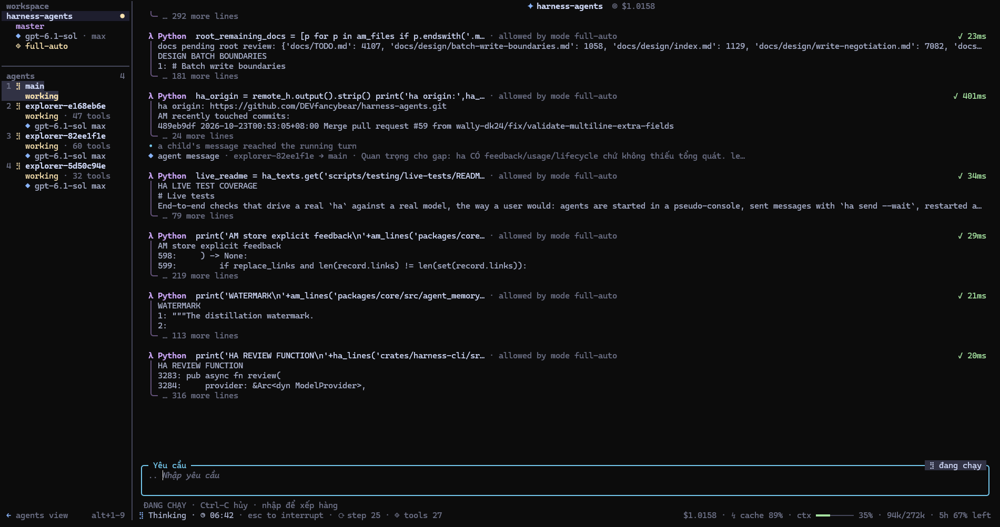
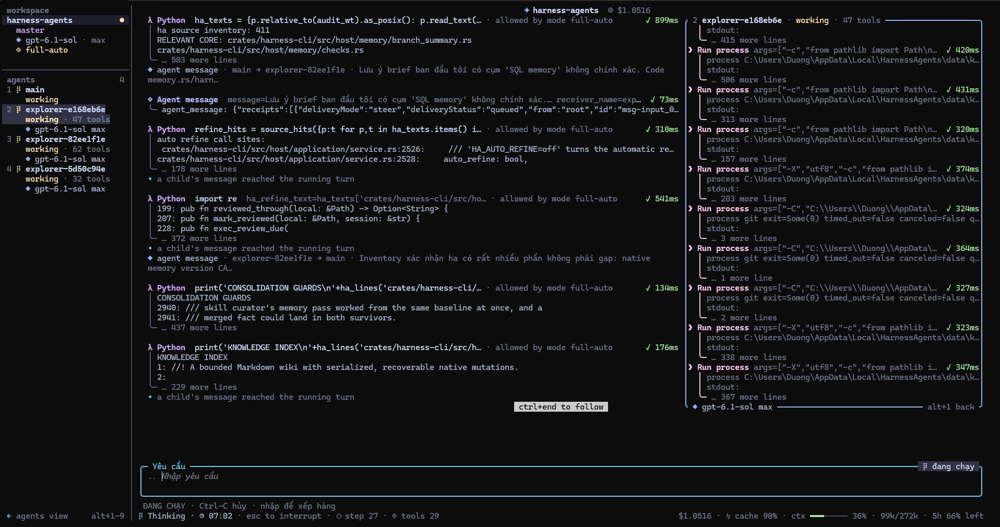
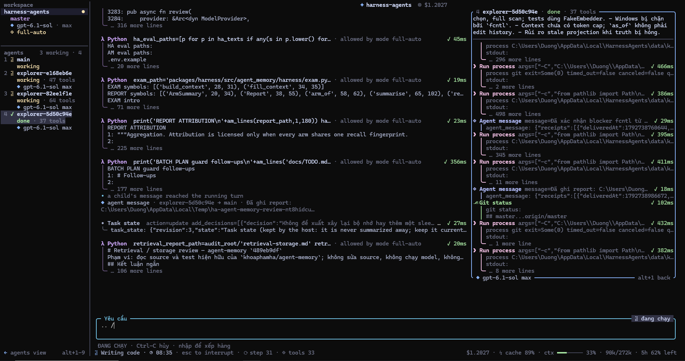

# Harness Agents

[](https://www.npmjs.com/package/harness-agents)
[](https://github.com/DEVfancybear/harness-agents/releases)


**A terminal coding agent whose harness, not the model, decides when the work is done.**
**Coding agent chạy trong terminal, nơi harness chứ không phải model quyết định khi nào việc đã xong, và không quên việc đã làm dù task kéo dài.**

`ha` reads, edits and runs your code through approval-gated tools. It checks its own work with your project's checks and an independent verifier, keeps every conversation in a local store, and remembers what should outlast a conversation in a memory you can audit, correct and turn off. It works with DeepSeek, OpenAI, Anthropic, ChatGPT Plus/Pro and OpenCode, and keeps their prompt caches hitting from one step to the next.

**Language / Ngôn ngữ:** [English](#english) · [Tiếng Việt](#tiếng-việt)

```powershell
npm install -g harness-agents
ha                      # then /login and start typing
```

### Screenshots / Ảnh chụp



*The main agent reads two repositories through the persistent Python REPL while three `explorer` children work in parallel; the sidebar lists each agent with its state, tool count and model, and a child's findings reach the running turn as a message. / Agent chính đọc hai repository qua Python REPL bền trong khi ba agent con `explorer` làm song song; sidebar liệt kê từng agent với trạng thái, số tool và model, và phát hiện của một agent con tới lượt đang chạy dưới dạng tin nhắn.*



*Alt+1..9 opens a child's pane beside the conversation: every call it makes, with its output, as it runs. / Alt+1..9 mở pane của một agent con cạnh cuộc hội thoại: từng lời gọi của nó, kèm output, ngay lúc chạy.*



*A finished explorer: its pane keeps its summary and the report it sent to the main agent, which records the decision in its task state. / Một explorer đã xong: pane giữ phần tóm tắt và báo cáo nó gửi cho agent chính, rồi agent chính ghi quyết định vào task state.*

---

## English

### Highlights

| | |
| --- | --- |
| **Guarded tools** | Read, search, patch and write files, run shell commands and processes, inspect Git, fetch and search the web. Every action passes the host policy (`ask`, `auto-edit` or `full-auto`), and its deny rules and [guards](docs/architecture/GUARDS.en.md) always hold. |
| **Persistent Python REPL** | prime-agent's kernel: variables survive across turns, `bash()` runs commands in the background, `rlm.spawn()` fans out explorer agents in parallel. |
| **Verified work** | `[verify]` checks the harness runs itself, an independent `verifier` agent that cannot edit and reports back to the running turn, goals that complete only when both pass, and a feature list only a real verification can mark passing. |
| **Long-running work** | `/goal` keeps working across turns, `ha exec --autonomous` loops until your gates pass, and background agents keep running after the terminal closes. A recovered agent comes back with the approval mode, profile and effort it was launched with. |
| **Long conversations** | Earlier turns are replayed with their tool calls, results, steers and host messages. Compaction extends one rolling summary instead of rewriting it, splits a turn too large to keep, anchors the latest state and keeps the list of files read and modified. `/resume`, `/tree` and forks move around the whole history. |
| **Memory** | The `memory` tool keeps what should outlast a conversation: your preferences globally, a project's facts for that project, task state per conversation. A corrected fact supersedes the old one, every entry records where its words came from (web and child entries are marked unverified), and unused entries expire. A fact can cite the code it rests on, checked on every read, or be kept for some files only. Changes you should have a say in wait for you (`/memory queue`). Search ranks by words, recency and use, and nothing leaves the machine. `HA_MEMORY=off` turns it all off and `HA_MEMORY_OFF` one feature at a time, to measure what it is worth. [Memory store](docs/architecture/MEMORY_STORE.en.md) |
| **Session continuity** | The host keeps one curated session log per conversation (decisions, learnings, fixes, files, pending tasks), and a new conversation starts from the previous one's. Recent commits, uncommitted files and the last `/handoff` are in the startup brief; `/recall` reads earlier logs. [Session continuity](docs/architecture/SESSION_CONTINUITY.en.md) |
| **Learning** | `/learn` turns what a conversation taught into `SKILL.md` skills; `/refine` tunes memory, skills, checks and prompt addendums. A background review does the same at checkpoints, after a goal completes or coders' work is merged. A correction seen in two conversations becomes a rule (`ha learning`). Skills pass a lint, are scored by whether your checks passed after they were used, are handed to child agents, and are archived when nobody uses them. [Learning loop](docs/architecture/LEARNING_LOOP.en.md) |
| **Models** | A catalog that follows the upstream one and keeps the models ha ships, GPT-6.1 Sol and Terra included. `/fast` takes the priority tier on GPT-5.4, 5.5, 5.6 and GPT-6, `/tier` any tier the model takes, `/effort` how much it reasons, and `Alt+M` cycles your scoped models. |
| **Prompt caching** | A follow-up request begins with the previous request word for word: tools are sorted, blocks already sent are not sent again, and history is replayed as it was sent. Each provider gets its cache key, breakpoints and retention, and the status line shows `↯ cache NN%`. |
| **Terminal interface** | A sidebar of every agent with its state, child panes beside the conversation, and a screen that redraws at up to about 60 frames a second while an answer streams, revealing it evenly instead of in bursts. [Terminal interface](docs/guides/TUI.md) |
| **Open ecosystem** | Agent Skills, MCP servers with OAuth sign-in and a service catalog (`/plugins`), prompt templates, hooks, `ha package` (npm, git, local), and `--mode rpc` / `--mode acp` for editors. |

### Install

**From npm** (Windows x64 release build):

```powershell
npm install -g harness-agents
ha --version
```

npm puts `ha` in its global directory (`npm prefix -g`), which Node's installer keeps on your PATH. Running `npm install -g harness-agents` again updates it.

**From source** (needs [Rust](https://rustup.rs), Git and PowerShell 7):

```powershell
git clone https://github.com/DEVfancybear/harness-agents.git
cd harness-agents
pwsh -NoProfile -File scripts/install/Install-Ha.ps1        # release build into %USERPROFILE%\.cargo\bin
```

To update a source install, pull and run `Install-Ha.ps1` again; `cargo build` alone does not replace the `ha` on your PATH (`Get-Command ha -All` shows which one runs). No key yet? `ha chat --fixture` opens the interface against a scripted provider.

### First run

```text
ha                         open the app
/login                     DeepSeek, OpenAI, Anthropic, OpenCode (API key) or ChatGPT Plus/Pro (browser)
/model                     pick a model your logins can use
/effort                    pick how much it reasons
/fast                      the priority tier, on the models that offer it
```

`ha "fix the failing test"` opens the app with a first prompt; `ha exec "…" --output-format json` runs one prompt for scripts and CI.

### Everyday commands

| You want to | Type |
| --- | --- |
| See every command | `/` (fuzzy menu), `/help`, `/help all`, `/hotkeys` |
| Continue or branch a conversation | `/resume`, `/tree`, `/fork`, `/clone`, `/btw`, `/new` |
| Attach files or images | `@`, `/attach <path>`, Ctrl-V for screenshots |
| Run a shell command | `!command` (goes through approval) |
| Redirect a running turn | `/steer <text>`, or just type while it runs; `/queue <text>` sends it after the turn |
| Work until something is done | `/goal <objective>`, `/goal status\|pause\|resume\|clear` |
| Check the work | `/verify`, `/review`, `/features`, `/self-eval [focus]` |
| Hand over to the next session | `/handoff`, `/handoff --reset`; `/recall [n] [topic]` reads earlier session logs |
| Keep what a session settled in the project instructions | `/preserve [focus]`: updates `AGENTS.md` (else `CLAUDE.md`) in place |
| Keep a lesson as a skill | `/learn [focus]`, then `/skills` |
| Tune memory, skills and checks | `/refine [instructions]`, `--global`, `--curate`, `--history [N]`, `--rollback <id>`; `/refinements off` turns the whole harness off (saved state is kept) |
| Review memory changes that wait for you | `/memory queue`, or `ha memory queue [show\|accept\|reject] <id>` |
| Forget something for good | `ha memory purge <id> --yes`, `ha memory purge --secrets --yes` |
| See what the agent learned from corrections | `ha learning list`, `ha learning report`, `ha learning retire <id>`, `ha learning export` / `import` |
| Keep a project's memory as markdown files in Git | `ha memory init`, `ha memory migrate`, `ha memory lint` |
| Search or manage saved research | `/knowledge`, `/knowledge search <query>`; `ha knowledge serve` opens the local console |
| Run faster, or pick a service tier | `/fast`, `/tier [tier]` |
| Shrink a long conversation | `/compact [what to keep]` |
| Connect services | `/plugins`, `/mcp add`, `/mcp login <service>`, `@server:uri` to attach a resource |
| Trust this project's config, hooks and MCP | `/trust`, then `/trust yes` |
| See cost, context, memory, permissions | `/cost`, `/context`, `/permissions` |
| Audit the repository for agents | `/doctor` or `ha doctor` |
| Report a bug | `/bug-report` or `ha bug-report` (one zip, secrets redacted) |

Keys: Enter sends, Ctrl-J or `\` then Enter add a line (Windows Terminal keeps Alt+Enter for full screen; Shift+Enter works where the console reports it), Esc interrupts, Ctrl-C cancels (twice on an empty prompt exits), Ctrl-O cycles collapsed / details / expanded, Ctrl-S stashes the draft, Alt+M cycles scoped models, Alt+1..9 opens a child's pane. See [Terminal interface](docs/guides/TUI.md).

### Background agents and automation

```powershell
ha agents                          # running agents and this project's conversations
ha attach <name>                   # reattach this terminal
ha send <name> "next step" --wait  # wake a saved conversation
ha send <name> "/goal" --wait      # slash commands run as commands and print what they show
ha stop <name>                     # stop it; the conversation stays
ha chat --model openai-codex/gpt-6.1-terra --approval full-auto
ha exec --autonomous --autonomous-gate "cargo test" "make the suite pass"
ha schedule                        # prompts that run later or on a schedule
ha --mode rpc                      # JSON commands on stdin, events on stdout
ha --mode acp                      # Agent Client Protocol over stdio
```

A per-project worker keeps sessions alive after the terminal closes and recovers them from its journal with the settings they were launched with (`HA_DAEMON=off` disables it). `--model provider/id` picks a catalog model together with its provider. In Git Bash, MSYS turns an argument starting with `/` into a Windows path (`/goal` becomes `C:/Program Files/Git/goal`); `ha send` reads such a command back and says so, and `MSYS_NO_PATHCONV=1` keeps it as typed.

### Configuration

Settings merge default → user `config.toml` → trusted project `.harness/config.toml` → environment → command line; `/config` shows where each value came from. Project checks live under `[verify]`:

```toml
[[verify.checks]]
name = "tests"
command = "cargo test --workspace"
hint = "Fix the failing test before finishing."
```

| Variable | Default | Meaning |
| --- | --- | --- |
| `DEEPSEEK_API_KEY`, `OPENAI_API_KEY`, `ANTHROPIC_API_KEY`, `OPENCODE_API_KEY` | — | Provider keys; a key saved with `/login` wins |
| `HA_PROVIDER_ENDPOINT` / `HA_PROVIDER_MODEL` | DeepSeek / `deepseek-v4-flash` | Any OpenAI-compatible chat endpoint and model |
| `HA_CACHE_RETENTION` | short | `long`: Anthropic's 1-hour cache, OpenAI's 24-hour retention |
| `HA_TURN_MAX_STEPS` / `HA_TURN_MAX_TOOL_CALLS` / `HA_TURN_DEADLINE_SECONDS` | no limit | Model calls, tool calls or seconds per turn before it pauses |
| `HA_COMPACT_AT` | 200000 | Tokens of context before it is compacted, however large the model's window (`0`: the window's own bound) |
| `HA_MEMORY` / `HA_MEMORY_OFF` | on / — | `off` turns memory off; `HA_MEMORY_OFF=digest,knowledge,...` turns off the named features only |
| `HA_MEMORY_REVIEW` | `policy` | Which memory changes wait for you: `policy`, `all` or `off` |
| `HA_MEMORY_EXPIRE_DAYS` | 28 | Days an unused entry is kept before it expires (`0`: never) |
| `HA_SKILL_PATHS` | — | Extra skill directories (e.g. `~/.claude/skills`) |
| `HA_AUTO_REFINE` / `HA_SKILL_LIFECYCLE` | on | `off` stops the background review / keeps unused learned skills |
| `HA_SELF_EVAL` / `HA_SESSION_LOG` | auto / on | `manual` or `off`: a large turn is not scored on its own; `off` stops the session logs |
| `SERPER_API_KEY` | — | Google results for `web_search`; the DeepSeek key also searches (DeepSeek Search), and DuckDuckGo needs no key |
| `HA_WEB_SEARCH` | `deepseek,serper` | Order of the search APIs `web_search` asks (`[web] search`); a failing one hands over to the next |
| `HA_WEB` / `HA_REPL` / `HA_DAEMON` | on | `off` removes web tools / the Python REPL / background agents |
| `HA_PYTHON` | `python3`, `python`, `py -3` | Interpreter for the REPL kernel (3.11+) |
| `HA_OFFLINE` | — | `1`: no network calls at startup (model catalog, model lists, update check) |
| `HA_UI` | auto | `plain` forces line mode |
| `HA_ALLOW_RECURSIVE_DELETE`, `HA_ALLOW_KILL_BY_NAME`, `HA_ALLOW_SECRET_PATHS`, `HA_ALLOW_ROOT_SEARCH`, `HA_ALLOW_HARNESS_WRITES`, `HA_ALLOW_SECRET_WRITES` | — | `1` lets through what a guard blocks ([Guards](docs/architecture/GUARDS.en.md)) |

Every setting and command is in the [operator guide](docs/guides/OPERATOR_GUIDE.en.md).

### Platform

| Platform | Status |
| --- | --- |
| Windows 10/11 x64 | Supported; every CI gate runs here |
| Linux | Pending: it builds and CI runs it, but it is not supported yet |
| macOS | Not tested |

### Development

```powershell
cargo fmt --all --check
cargo clippy --locked --workspace --all-targets -- -D warnings
cargo test --locked --workspace --no-fail-fast
pwsh -NoProfile -File scripts/verify/Verify-Docs.ps1
```

A change a user can see is done only when it has also passed live, with the real `ha` against a real model: [AGENTS.md](AGENTS.md) says how, and the [live tests](scripts/testing/live-tests/README.md) list the suites.

### Documentation

- [Operator guide](docs/guides/OPERATOR_GUIDE.en.md): every command, setting and workflow, and what each release changed
- [Documentation index](docs/README.md): architecture, memory, learning, guards and the terminal interface
- [Build and release](docs/guides/BUILD_AND_RELEASE.md) · [Changelog](https://github.com/DEVfancybear/harness-agents/releases)

---

## Tiếng Việt

### Điểm nổi bật

| | |
| --- | --- |
| **Công cụ có kiểm soát** | Đọc, tìm, sửa và ghi file, chạy lệnh shell và tiến trình, xem Git, tìm và đọc web. Mọi thao tác đi qua chính sách của host (`ask`, `auto-edit` hoặc `full-auto`), còn rule deny và các [guard](docs/architecture/GUARDS.vi.md) luôn được giữ. |
| **Python REPL bền** | Kernel của prime-agent: biến được giữ qua các lượt, `bash()` chạy lệnh nền, `rlm.spawn()` chạy song song các agent khám phá. |
| **Kiểm chứng thật** | Các check `[verify]` do harness tự chạy, agent `verifier` độc lập không được sửa file và báo về lượt đang chạy, goal chỉ hoàn thành khi cả hai qua, và feature list chỉ được đánh dấu passing bằng một lượt kiểm chứng thật. |
| **Việc dài hơi** | `/goal` làm tiếp qua nhiều lượt, `ha exec --autonomous` lặp tới khi các gate qua, agent nền vẫn chạy sau khi đóng terminal. Agent được khôi phục giữ nguyên chế độ duyệt, profile và mức suy luận lúc khởi chạy. |
| **Hội thoại dài** | Các lượt trước được phát lại cùng tool call, kết quả, steer và tin nhắn của host. Compaction nối thêm vào một bản tóm tắt cuốn chiếu thay vì viết lại, tách lượt quá lớn, neo trạng thái mới nhất và giữ danh sách các file đã đọc và đã sửa. `/resume`, `/tree` và fork để đi lại trong toàn bộ lịch sử. |
| **Trí nhớ** | Tool `memory` giữ điều cần sống lâu hơn một hội thoại: sở thích của bạn ở global, dữ kiện của một project cho project đó, trạng thái việc theo từng hội thoại. Dữ kiện được sửa sẽ thay thế (supersede) dữ kiện cũ, mỗi mục ghi lại chữ của nó đến từ đâu (mục từ web và từ agent con bị đánh dấu chưa kiểm chứng), và mục không ai dùng sẽ hết hạn. Một dữ kiện có thể trích dẫn đoạn code nó dựa vào, được kiểm lại mỗi lần đọc, hoặc chỉ được giữ cho một số file. Thay đổi mà bạn nên có tiếng nói sẽ chờ bạn duyệt (`/memory queue`). Tìm kiếm xếp hạng theo từ, độ mới và mức dùng, không gì rời khỏi máy. `HA_MEMORY=off` tắt toàn bộ, `HA_MEMORY_OFF` tắt từng tính năng, để đo xem memory đáng giá đến đâu. [Kho memory](docs/architecture/MEMORY_STORE.vi.md) |
| **Liền mạch giữa các phiên** | Host giữ một session log đã chắt lọc cho mỗi hội thoại (quyết định, bài học, cách sửa, file, việc còn dở), và hội thoại mới bắt đầu từ log của hội thoại trước. Tóm tắt lúc mở phiên có commit gần đây, file chưa commit và `/handoff` cuối; `/recall` đọc lại các log trước. [Liền mạch giữa các phiên](docs/architecture/SESSION_CONTINUITY.vi.md) |
| **Tự học** | `/learn` đúc điều hội thoại vừa dạy thành skill `SKILL.md`; `/refine` tinh chỉnh memory, skill, check và phần bổ sung prompt. Lượt review nền làm việc này ở các điểm dừng, sau khi một goal hoàn thành hoặc việc của coder được gộp. Lời sửa thấy ở hai hội thoại tự thành rule (`ha learning`). Skill qua lint, được chấm theo việc check của bạn có qua sau khi dùng hay không, được chuyển cho agent con, và bị lưu trữ khi không ai dùng. [Vòng học](docs/architecture/LEARNING_LOOP.vi.md) |
| **Model** | Catalog bám theo bản upstream mà vẫn giữ các model ha mang sẵn, kể cả GPT-6.1 Sol và Terra. `/fast` dùng tier priority trên GPT-5.4, 5.5, 5.6 và GPT-6, `/tier` chọn tier bất kỳ mà model nhận, `/effort` chọn mức suy luận, `Alt+M` xoay vòng các model đã chọn. |
| **Prompt caching** | Request tiếp theo bắt đầu bằng đúng nguyên văn request trước: tool được sắp xếp, khối đã gửi không gửi lại, lịch sử được phát lại đúng như đã gửi. Mỗi provider nhận cache key, breakpoint và thời hạn riêng, thanh trạng thái hiện `↯ cache NN%`. |
| **Giao diện terminal** | Sidebar liệt kê mọi agent kèm trạng thái, pane của agent con cạnh cuộc hội thoại, và màn hình vẽ lại tới khoảng 60 khung mỗi giây khi câu trả lời đang stream, cho chữ hiện ra đều thay vì từng cục. [Giao diện terminal](docs/guides/TUI.md) |
| **Hệ sinh thái mở** | Agent Skills, MCP server có đăng nhập OAuth và danh mục dịch vụ (`/plugins`), prompt template, hook, `ha package` (npm, git, local), và `--mode rpc` / `--mode acp` cho editor. |

### Cài đặt

**Từ npm** (bản release Windows x64):

```powershell
npm install -g harness-agents
ha --version
```

npm đặt `ha` vào thư mục global của nó (`npm prefix -g`), thư mục mà trình cài Node giữ trong PATH. Chạy lại `npm install -g harness-agents` để cập nhật.

**Từ mã nguồn** (cần [Rust](https://rustup.rs), Git và PowerShell 7):

```powershell
git clone https://github.com/DEVfancybear/harness-agents.git
cd harness-agents
pwsh -NoProfile -File scripts/install/Install-Ha.ps1        # build release vào %USERPROFILE%\.cargo\bin
```

Cập nhật bản build từ nguồn: `git pull` rồi chạy lại `Install-Ha.ps1`; chỉ `cargo build` thì không thay `ha` trong PATH (`Get-Command ha -All` cho biết bản nào đang chạy). Chưa có key? `ha chat --fixture` mở giao diện với provider giả lập.

### Lần chạy đầu

```text
ha                         mở app
/login                     DeepSeek, OpenAI, Anthropic, OpenCode (API key) hoặc ChatGPT Plus/Pro (trình duyệt)
/model                     chọn model mà tài khoản dùng được
/effort                    chọn mức suy luận
/fast                      tier priority, trên các model có hỗ trợ
```

`ha "sửa test đang fail"` mở app kèm prompt đầu tiên; `ha exec "…" --output-format json` chạy một prompt cho script và CI.

### Lệnh hằng ngày

| Bạn muốn | Gõ |
| --- | --- |
| Xem mọi lệnh | `/` (menu tìm mờ), `/help`, `/help all`, `/hotkeys` |
| Tiếp tục hoặc rẽ nhánh hội thoại | `/resume`, `/tree`, `/fork`, `/clone`, `/btw`, `/new` |
| Đính kèm file hoặc ảnh | `@`, `/attach <path>`, Ctrl-V để dán ảnh chụp |
| Chạy lệnh shell | `!command` (đi qua phê duyệt) |
| Chỉnh hướng lượt đang chạy | `/steer <text>`, hoặc gõ luôn khi nó đang chạy; `/queue <text>` gửi sau khi lượt xong |
| Làm tới khi xong việc | `/goal <mục tiêu>`, `/goal status\|pause\|resume\|clear` |
| Kiểm tra kết quả | `/verify`, `/review`, `/features`, `/self-eval [trọng tâm]` |
| Bàn giao cho phiên sau | `/handoff`, `/handoff --reset`; `/recall [n] [chủ đề]` đọc lại session log trước |
| Giữ điều phiên này đã chốt trong file chỉ dẫn của project | `/preserve [trọng tâm]`: sửa tại chỗ `AGENTS.md` (không có thì `CLAUDE.md`) |
| Giữ bài học thành skill | `/learn [trọng tâm]`, rồi `/skills` |
| Tinh chỉnh memory, skill và check | `/refine [chỉ dẫn]`, `--global`, `--curate`, `--history [N]`, `--rollback <id>`; `/refinements off` tắt toàn bộ harness (state đã lưu được giữ) |
| Duyệt các thay đổi memory đang chờ bạn | `/memory queue`, hoặc `ha memory queue [show\|accept\|reject] <id>` |
| Quên hẳn một điều | `ha memory purge <id> --yes`, `ha memory purge --secrets --yes` |
| Xem agent đã học gì từ lời sửa | `ha learning list`, `ha learning report`, `ha learning retire <id>`, `ha learning export` / `import` |
| Giữ memory của project bằng file markdown trong Git | `ha memory init`, `ha memory migrate`, `ha memory lint` |
| Tìm hoặc quản lý nghiên cứu đã lưu | `/knowledge`, `/knowledge search <query>`; `ha knowledge serve` mở console cục bộ |
| Chạy nhanh hơn, hoặc chọn service tier | `/fast`, `/tier [tier]` |
| Rút gọn hội thoại dài | `/compact [điều cần giữ]` |
| Kết nối dịch vụ | `/plugins`, `/mcp add`, `/mcp login <service>`, `@server:uri` để đính kèm resource |
| Trust config, hook và MCP của project | `/trust`, rồi `/trust yes` |
| Xem chi phí, context, memory, quyền | `/cost`, `/context`, `/permissions` |
| Audit repo cho agent | `/doctor` hoặc `ha doctor` |
| Báo lỗi | `/bug-report` hoặc `ha bug-report` (một file zip, đã che secret) |

Phím: Enter gửi, Ctrl-J hoặc `\` rồi Enter để xuống dòng (Windows Terminal giữ Alt+Enter cho chế độ toàn màn hình; Shift+Enter dùng được nơi console báo phím Shift), Esc ngắt lượt, Ctrl-C hủy (bấm hai lần trên dòng trống để thoát), Ctrl-O đổi thu gọn / chi tiết / mở rộng, Ctrl-S cất bản nháp, Alt+M đổi sang model kế tiếp trong danh sách đã chọn, Alt+1..9 mở pane của agent con. Xem [Giao diện terminal](docs/guides/TUI.md).

### Agent nền và tự động hóa

```powershell
ha agents                          # các agent đang chạy và các hội thoại của project
ha attach <name>                   # gắn lại terminal này
ha send <name> "bước tiếp" --wait  # đánh thức một hội thoại đã lưu
ha send <name> "/goal" --wait      # lệnh slash được chạy như lệnh và in ra nội dung
ha stop <name>                     # dừng agent; hội thoại vẫn được giữ
ha chat --model openai-codex/gpt-6.1-terra --approval full-auto
ha exec --autonomous --autonomous-gate "cargo test" "làm cho bộ test qua"
ha schedule                        # prompt chạy sau hoặc theo lịch
ha --mode rpc                      # lệnh JSON qua stdin, sự kiện qua stdout
ha --mode acp                      # Agent Client Protocol qua stdio
```

Mỗi project có một worker giữ các phiên sống sau khi đóng terminal và khôi phục chúng từ journal cùng cấu hình lúc khởi chạy (`HA_DAEMON=off` để tắt). `--model provider/id` chọn model trong catalog cùng provider của nó. Trong Git Bash, MSYS đổi tham số bắt đầu bằng `/` thành đường dẫn Windows (`/goal` thành `C:/Program Files/Git/goal`); `ha send` nhận ra và đọc lại thành lệnh, có báo, còn `MSYS_NO_PATHCONV=1` giữ nguyên như đã gõ.

### Cấu hình

Cấu hình được gộp theo thứ tự mặc định → `config.toml` của người dùng → `.harness/config.toml` của project đã trust → biến môi trường → dòng lệnh; `/config` cho biết mỗi giá trị đến từ đâu. Check của project nằm trong `[verify]`:

```toml
[[verify.checks]]
name = "tests"
command = "cargo test --workspace"
hint = "Sửa test đang fail trước khi kết thúc."
```

| Biến | Mặc định | Ý nghĩa |
| --- | --- | --- |
| `DEEPSEEK_API_KEY`, `OPENAI_API_KEY`, `ANTHROPIC_API_KEY`, `OPENCODE_API_KEY` | — | Khóa provider; khóa lưu bằng `/login` được ưu tiên |
| `HA_PROVIDER_ENDPOINT` / `HA_PROVIDER_MODEL` | DeepSeek / `deepseek-v4-flash` | Endpoint chat tương thích OpenAI và model bất kỳ |
| `HA_CACHE_RETENTION` | short | `long`: cache 1 giờ của Anthropic, giữ 24 giờ của OpenAI |
| `HA_TURN_MAX_STEPS` / `HA_TURN_MAX_TOOL_CALLS` / `HA_TURN_DEADLINE_SECONDS` | không giới hạn | Số lời gọi model, lời gọi tool hoặc số giây mỗi lượt trước khi tạm dừng |
| `HA_COMPACT_AT` | 200000 | Số token context trước khi compact, dù cửa sổ của model lớn đến đâu (`0`: theo giới hạn của chính cửa sổ) |
| `HA_MEMORY` / `HA_MEMORY_OFF` | bật / — | `off` tắt memory; `HA_MEMORY_OFF=digest,knowledge,...` chỉ tắt các tính năng được nêu |
| `HA_MEMORY_REVIEW` | `policy` | Thay đổi memory nào phải chờ bạn duyệt: `policy`, `all` hoặc `off` |
| `HA_MEMORY_EXPIRE_DAYS` | 28 | Số ngày một mục không ai dùng được giữ trước khi hết hạn (`0`: không bao giờ) |
| `HA_SKILL_PATHS` | — | Thư mục skill bổ sung (ví dụ `~/.claude/skills`) |
| `HA_AUTO_REFINE` / `HA_SKILL_LIFECYCLE` | bật | `off` tắt lượt review nền / giữ cả skill không dùng |
| `HA_SELF_EVAL` / `HA_SESSION_LOG` | auto / bật | `manual` hoặc `off`: lượt lớn không tự được chấm; `off` để host thôi ghi session log |
| `SERPER_API_KEY` | — | Kết quả Google cho `web_search`; key DeepSeek cũng tìm được (DeepSeek Search); DuckDuckGo không cần key |
| `HA_WEB_SEARCH` | `deepseek,serper` | Thứ tự các search API mà `web_search` dùng (`[web] search`); API lỗi thì chuyển sang API kế tiếp |
| `HA_WEB` / `HA_REPL` / `HA_DAEMON` | bật | `off` gỡ tool web / Python REPL / agent nền |
| `HA_PYTHON` | `python3`, `python`, `py -3` | Trình thông dịch cho kernel REPL (3.11+) |
| `HA_OFFLINE` | — | `1`: không gọi mạng lúc khởi động (catalog model, danh sách model, kiểm tra cập nhật) |
| `HA_UI` | tự động | `plain` ép chế độ dòng lệnh |
| `HA_ALLOW_RECURSIVE_DELETE`, `HA_ALLOW_KILL_BY_NAME`, `HA_ALLOW_SECRET_PATHS`, `HA_ALLOW_ROOT_SEARCH`, `HA_ALLOW_HARNESS_WRITES`, `HA_ALLOW_SECRET_WRITES` | — | `1` cho phép điều mà một guard chặn ([Guard](docs/architecture/GUARDS.vi.md)) |

Mọi cấu hình và lệnh có trong [hướng dẫn vận hành](docs/guides/OPERATOR_GUIDE.vi.md).

### Nền tảng

| Nền tảng | Trạng thái |
| --- | --- |
| Windows 10/11 x64 | Hỗ trợ; mọi gate CI chạy ở đây |
| Linux | Đang chờ: build được và CI có chạy, nhưng chưa được hỗ trợ |
| macOS | Chưa kiểm thử |

### Phát triển

```powershell
cargo fmt --all --check
cargo clippy --locked --workspace --all-targets -- -D warnings
cargo test --locked --workspace --no-fail-fast
pwsh -NoProfile -File scripts/verify/Verify-Docs.ps1
```

Một thay đổi người dùng thấy được chỉ xong khi đã qua cả kiểm thử live, với `ha` thật và model thật: [AGENTS.md](AGENTS.md) nói cách làm, [live tests](scripts/testing/live-tests/README.md) liệt kê các suite.

### Tài liệu

- [Hướng dẫn vận hành](docs/guides/OPERATOR_GUIDE.vi.md): mọi lệnh, cấu hình và quy trình, và mỗi bản release đã đổi gì
- [Mục lục tài liệu](docs/README.md): kiến trúc, memory, vòng học, guard và giao diện terminal
- [Build và release](docs/guides/BUILD_AND_RELEASE.md) · [Changelog](https://github.com/DEVfancybear/harness-agents/releases)

---

Design references / Nguồn tham khảo thiết kế: [prime-agent](https://github.com/PrimeIntellect-ai/prime-agent) · [pi](https://github.com/earendil-works/pi/tree/d5629e20489ccf770ed90b5a33941cb3b7ef24d0) · [Codex](https://github.com/openai/codex) · [DeepSeek Harness](https://github.com/deepseek-ai/deepseek-harness/tree/2377c272a8e839e0a84c9f0e623b867a1dce2014) · [learn-harness-engineering](https://github.com/walkinglabs/learn-harness-engineering) · [TencentDB Agent Memory](https://github.com/TencentCloud/TencentDB-Agent-Memory/tree/906b5823b5106eed8f842b62f16d23228838149a) · [deer-flow](https://github.com/bytedance/deer-flow/tree/29dbce45a12cffe4ce7c395dde6e4b913748596b) · [memory-engine](https://github.com/timescale/memory-engine).
